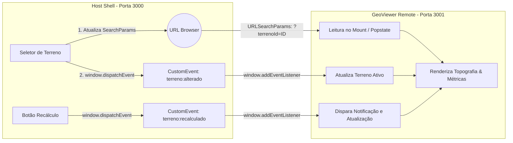

# Relatório Didático: Comunicação Desacoplada entre Micro Frontends

Este documento detalha o **Cenário C (Comunicação Desacoplada)** previsto no [PRD.md](file:///c:/Users/Bruno/Documents/Projetos/labs/lab-module-federation/docs/PRD.md) e implementado na **Tarefa 5** do [TASKS.md](file:///c:/Users/Bruno/Documents/Projetos/labs/lab-module-federation/docs/TASKS.md).

---

## 1. Visão Geral e Problema Arquitetural

Em uma arquitetura de Micro Frontends orquestrada com Module Federation, cada aplicação possui ciclos de vida, deploys e repositórios desacoplados.

Um dos erros mais comuns em equipes iniciantes em Micro Frontends é tentar **compartilhar estados globais pesados** (como uma store do Redux, instâncias de Context API ou stores do Zustand) diretamente através da fronteira de federação via `shared`.

### Os Riscos do Compartilhamento Rígido de Estado (Context API / Redux Compartilhado):
1. **Acoplamento em Tempo de Compilação e Execução:** Ambas as aplicações passam a depender do mesmo contrato de tipos e da mesma estrutura de árvore de dados em memória.
2. **Quebra de Hooks e Context Missing:** Para que um `useContext` funcione no micro frontend remoto, o provedor (`<Provider>`) precisa ser instanciado no Host e a instância exata de contexto precisa ser compartilhada via Module Federation. Qualquer desalinhamento de versão de React ou empacotador faz o contexto retornar `undefined` em runtime.
3. **Impossibilidade de Deploys Autônomos:** Uma mudança no schema da store em um MFE força a recompilação e redeploy sincronizado de todos os outros.
4. **Perda de Deep Linking e Histórico:** Estados armazenados exclusivamente em memória são perdidos ao atualizar a página (`F5`) ou ao compartilhar links entre usuários.

---

## 2. Os Dois Padrões Recomendados da Indústria

Para garantir isolamento, autonomia e alta interoperabilidade, implementamos dois padrões universais e nativos da Web:



---

### Padrão 1: Estado na URL (Query Params / `URLSearchParams`) como Fonte da Verdade

A URL é a forma mais durável, auditável e resiliente de sincronizar estado entre containers independentes.

#### Como o Host atualiza:
Utiliza a API de roteamento (`useSearchParams` do `react-router-dom`) para alterar os query parameters sem disparar reload da página:
```typescript
const [searchParams, setSearchParams] = useSearchParams();

const handleSelectTerreno = (terrenoId: string) => {
  setSearchParams({ terrenoId }); // Atualiza ?terrenoId=ID na barra do navegador

  // Notifica o Remote que escuta o barramento
  window.dispatchEvent(
    new CustomEvent('terreno:alterado', { detail: { terrenoId } })
  );
};
```

#### Como o Remote lê:
O micro frontend remoto (`GeoViewer`) consome `window.location.search` utilizando a API nativa `URLSearchParams`, garantindo que funcione de forma autônoma tanto encapsulado pelo Host quanto isolado em modo preview:
```typescript
function getTerrenoIdFromUrl(): string {
  const params = new URLSearchParams(window.location.search);
  const id = params.get('terrenoId');
  return id && MOCK_TERRAINS[id] ? id : '101';
}
```

#### Vantagens:
* **Deep Linking Imediato:** Qualquer usuário pode compartilhar o link direto `http://localhost:3000/terreno?terrenoId=202` e carregar exatamente o mesmo estado.
* **Histórico do Navegador:** Suporte nativo aos botões Voltar (`Back`) e Avançar (`Forward`) do navegador através de eventos `popstate`.
* **Zero Dependência Externa:** Funciona com qualquer framework (React, Vue, Angular ou Vanilla JS).

---

### Padrão 2: Eventos Nativos do Navegador (`CustomEvent`) para Disparos e Notificações

Para ações transitórias, notificações pontuais e comandos que não devem poluir a URL, o barramento nativo do DOM (`window.dispatchEvent` / `window.addEventListener`) provê um desacoplamento ideal.

#### Contrato de Tipagem Estrita:
```typescript
export interface TerrenoRecalculadoDetail {
  timestamp: number;
  versao: string;
}

export interface TerrenoAlteradoDetail {
  terrenoId: string;
}
```

#### Emissão pelo Host:
```typescript
const handleDispararRecalculo = () => {
  const detail: TerrenoRecalculadoDetail = {
    timestamp: Date.now(),
    versao: Math.random().toFixed(2),
  };

  window.dispatchEvent(
    new CustomEvent<TerrenoRecalculadoDetail>('terreno:recalculado', { detail })
  );
};
```

#### Escuta e Limpeza Obrigatória no Remote (`GeoViewer`):
```typescript
useEffect(() => {
  const handleRecalculado = (e: Event) => {
    const customEvent = e as CustomEvent<TerrenoRecalculadoDetail>;
    if (customEvent.detail) {
      setRecalcEvent(customEvent.detail);
      setShowRecalcBanner(true);
    }
  };

  window.addEventListener('terreno:recalculado', handleRecalculado);

  // OBRIGATÓRIO: Desinscrever o listener no unmount para evitar Memory Leaks
  return () => {
    window.removeEventListener('terreno:recalculado', handleRecalculado);
  };
}, []);
```

---

## 3. Matriz Comparativa de Arquitetura

| Critério | URL State + CustomEvent (Recomendado) | Context API / Redux Compartilhado |
| :--- | :--- | :--- |
| **Grau de Acoplamento** | **Muito Baixo (Desacoplado)** | Alto (Fortemente acoplado) |
| **Suporte a Deep Linking** | **Sim (Nativo na URL)** | Não (Estado volátil em memória) |
| **Compatibilidade entre Frameworks** | **100% (APIs Web nativas do navegador)** | 0% (Restrito à mesma biblioteca/framework) |
| **Risco de Memory Leak** | **Mínimo** (resolvido com `removeEventListener`) | Médio/Alto (retenção de referências na store) |
| **Resiliência se um MFE falhar** | **Alta** (Host continua operando independentemente) | Baixa (erro no provider derruba o host) |
| **Deploy Autônomo** | **Totalmente Independente** | Risco de incompatibilidade de schemas |

---

## 4. Roteiro de Testes e Demonstração

### Teste 1: Alternância de Terrenos via URL (Query Params)
1. Acesse `http://localhost:3000/terreno`.
2. Observe que por padrão o terreno ativo é o **Terreno Alpha (ID: 101)** com zoneamento `ZEU`.
3. Clique em **"Terreno Beta (ID: 202)"**:
   - A barra de endereços é atualizada para `?terrenoId=202` sem recarregar a página.
   - O componente remoto altera instantaneamente o nome para **"Lote Beta — Planalto Sul"**, área para `28.400 m²`, zoneamento para `ZPR` e redesenha a malha topográfica.
4. Clique em **"Terreno Gamma (ID: 303)"**:
   - A URL atualiza para `?terrenoId=303`.
   - O componente altera para **"Reserva Gamma — Encosta Leste"**, área para `42.100 m²` e zoneamento para `ZEP`.

### Teste 2: Deep Link Direto
1. Abra uma nova aba no navegador e cole diretamente:
   `http://localhost:3000/terreno?terrenoId=202`
2. O micro frontend remoto já inicializa lendo o parâmetro e renderiza diretamente o **Lote Beta**.

### Teste 3: Disparo de Ação e Notificação Lateral (`CustomEvent`)
1. Com qualquer terreno selecionado, clique no botão **"⚡ Disparar Recálculo de Parâmetros"** no painel do Host.
2. O Host despacha o evento `'terreno:recalculado'` com timestamp e versão gerada.
3. Imediatamente, o micro frontend remoto (`GeoViewer`) recebe o evento e renderiza o banner de notificação:
   `CustomEvent: terreno:recalculado — Versão: X.XX (Horário: HH:mm:ss)`.
4. Clique no botão de fechar (**✕**) no banner para dispensar a notificação.
