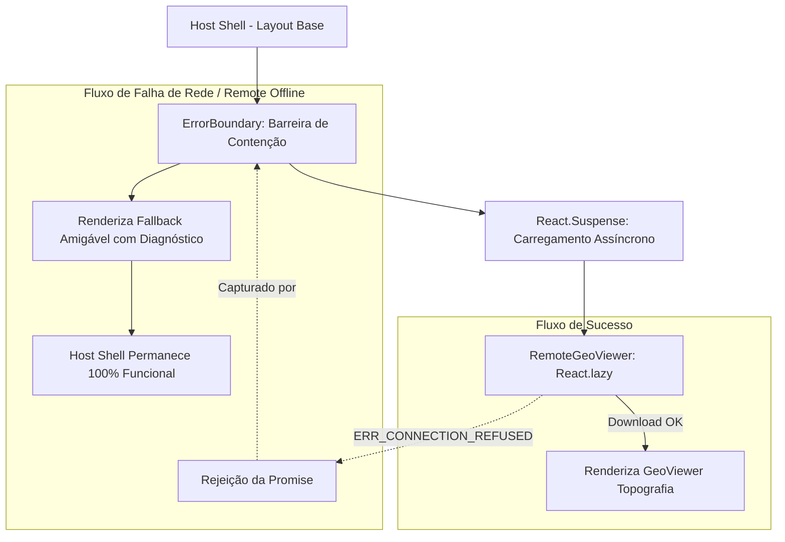

# Relatório Didático: Resiliência com ErrorBoundary e Suspense no Module Federation

## 1. Contexto e Objetivo
Em uma arquitetura de Micro Frontends, cada módulo remoto é distribuído e executado por servidores ou CDNs independentes. Uma falha de infraestrutura no serviço remoto (porta 3001 indisponível, falha de rede transitória ou erro no chunk `remoteEntry.js`) **não pode jamais derrubar o container principal (Host Shell)**.

Este relatório documenta o **Cenário B (Resiliência de Rede)** definido no [PRD.md](file:///c:/Users/Bruno/Documents/Projetos/labs/lab-module-federation/docs/PRD.md) e implementado na **Tarefa 4** do [TASKS.md](file:///c:/Users/Bruno/Documents/Projetos/labs/lab-module-federation/docs/TASKS.md):
1. Demonstração do comportamento de **Tela Branca (White Screen of Death)** quando o Remote cai sem proteção.
2. Análise do ciclo de vida assíncrono: a diferença e a sinergia entre **`React.Suspense`** e **`ErrorBoundary`**.
3. O desafio do cache de promessas rejeitadas do **`React.lazy`** e a estratégia de recuperação com chave dinâmica.
4. Implementação de nível sênior do fallback amigável com diagnóstico e botão de recuperação ("Tentar Novamente").

---

## 2. O Cenário sem Resiliência (Tela Branca / Crash do Host)

### Como o Remote é importado originalmente
```typescript
// Sem barreira de contenção (ErrorBoundary)
const RemoteGeoViewer = lazy(() => import('remoteApp/GeoViewer'));

function TerrainPage() {
  return (
    <Suspense fallback={<Loading />}>
      <RemoteGeoViewer />
    </Suspense>
  );
}
```

### O que acontece quando o Remote está offline (porta 3001 caída)?
1. O usuário acessa a rota `/terreno` no Host (`localhost:3000`).
2. O `React.lazy` aciona o dynamic import do módulo remoto (`http://localhost:3001/assets/remoteEntry.js`).
3. Como a porta 3001 está inativa, a requisição de rede falha com `ERR_CONNECTION_REFUSED`.
4. A Promise rejeita com:
   ```text
   TypeError: Failed to fetch dynamically imported module: http://localhost:3001/assets/remoteEntry.js
   ```
5. O `React.Suspense` apenas aguarda Promises **pendentes**. Quando a Promise é **rejeitada**, o erro borbulha para cima na árvore de componentes.
6. Sem nenhum `ErrorBoundary` no caminho, o React 18 desmonta **toda a raiz da aplicação** para evitar estado corrompido.
7. **Resultado:** A tela inteira fica em branco (**White Screen of Death**). O usuário perde o cabeçalho, a barra lateral de navegação e todas as demais páginas do Host.

---

## 3. A Arquitetura de Resiliência: ErrorBoundary + Suspense

Para garantir alta disponibilidade e isolamento de falhas (*fault isolation*), combinamos duas camadas complementares:



### Papel do `React.Suspense`
- Intercepta Promises no estado **pending** lançadas durante a renderização (`throw promise`).
- Renderiza o componente de loading transitório (`<TerrainLoadingFallback />`) enquanto os scripts remotos estão sendo transferidos pela rede.

### Papel do `ErrorBoundary`
- Componente de classe React implementando `getDerivedStateFromError` e `componentDidCatch`.
- Intercepta erros síncronos e Promises no estado **rejected**.
- Impede que o erro suba para os componentes pais, confinando a falha exclusivamente ao container do micro frontend.
- Renderiza uma interface de degradação graciosa com diagnóstico técnico e ações de auto-recuperação.

---

## 4. O Desafio do Cache de Promessas do `React.lazy` e a Solução de Recuperação

Um dos problemas mais sutis em produção com `React.lazy` e micro frontends é o **cache de promessas rejeitadas**:

> **O Problema:** Quando `React.lazy(() => import(...))` falha uma vez, a instância interna do React armazena o status `Rejected` e o objeto de erro. Se o usuário clicar em "Tentar Novamente" e o `ErrorBoundary` apenas limpar seu estado de erro (`hasError: false`), o React re-renderiza o mesmo componente lazy, o qual **imediatamente relança o erro em cache sem realizar nenhuma nova requisição de rede**.

### A Solução Arquitetural no Host (`App.tsx`)
Utilizamos uma chave de recriação (`retryKey`) combinada com `useMemo`:

```typescript
function TerrainPage() {
  const [retryKey, setRetryKey] = useState(0);

  // Recria a fábrica do React.lazy a cada incremento de retryKey
  const LazyGeoViewer = useMemo(() => {
    return lazy(() => import('remoteApp/GeoViewer'));
  }, [retryKey]);

  const handleReset = () => {
    // Força uma nova instância limpa do lazy, executando uma nova requisição de rede
    setRetryKey((prev) => prev + 1);
  };

  return (
    <ErrorBoundary
      key={retryKey}
      moduleName="remoteApp/GeoViewer"
      remoteUrl="http://localhost:3001/assets/remoteEntry.js"
      onReset={handleReset}
    >
      <Suspense fallback={<TerrainLoadingFallback />}>
        <LazyGeoViewer />
      </Suspense>
    </ErrorBoundary>
  );
}
```

Ao clicar em **"Tentar Novamente"**:
1. O `onReset` do `ErrorBoundary` incrementa `retryKey`.
2. O `useMemo` descarta a referência antiga e gera uma nova instância do `React.lazy`.
3. Uma nova requisição HTTP real para `http://localhost:3001/assets/remoteEntry.js` é disparada.
4. Se o Remote tiver sido reativado, o componente monta instantaneamente com sucesso!

---

## 5. Como Testar e Demonstrar no Projeto

### Teste 1: Simulação no Navegador (Didático / 1-Click)
1. Acesse o Host em `http://localhost:3000`.
2. Clique na rota **Visualizador de Terreno** no menu lateral.
3. No topo da página, clique no botão **"⚡ Simular Falha no Remote"**.
4. Observe que o `GeoViewer` é substituído pelo card de fallback resiliente com detalhes do erro e diagnóstico.
5. Note que o cabeçalho do Host, badges e a navegação lateral continuam totalmente intactos.
6. Clique no botão **"🔄 Tentar Novamente"** para restaurar e recarregar o componente com sucesso.

### Teste 2: Teste Real de Rede (Desligando o Servidor Remote)
1. Certifique-se de que o Host está rodando em `localhost:3000`.
2. Interrompa o servidor do Remote na porta 3001 (`Ctrl+C` no terminal do remote).
3. Atualize a página `/terreno` no Host.
4. O `ErrorBoundary` capturará o erro de rede real (`Failed to fetch dynamically imported module`), mantendo o Shell operacional.
5. Reinicie o servidor do Remote (`npm run preview:remote`).
6. Clique no botão **"🔄 Tentar Novamente"** no card de erro do Host. O componente topográfico carregará normalmente sem precisar recarregar o navegador.
